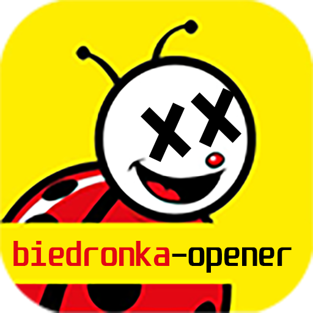

<h1 align="center">
  biedronka-opener
  <br>
</h1>
<p align="center">
    
</p>

<h4 align="center">A Python script to automatically open biedronka shakeomat and send loot notifications to Discord</h4>
<h3 align="center">DISCLAIMER!<br>This project is intended solely for educational purposes and does not encourage the penetration testing or reverse engineering of any applications.</h2>

<p align="center">
  <a href="#how-to-use">How to use</a> •
  <a href="#support">Support</a> •
  <a href="#support-the-developers">Support the Developers</a> •
  <a href="#license">License</a>
</p>

## How to use

You must have [HTTP Toolkit](https://httptoolkit.com/)

```bash
# Clone this repository
$ git clone https://github.com/fixedzik/biedronka-opener.git
```

```bash
# Fill your credentials file with your refresh token* and discord webhook
$ cd biedronka-opener
$ vim .env

# * you can find a guide to refresh token in private/guide.mp4
```

```bash
# Install the requirements
$ pip install -r requirements.txt

# Enable the script
$ python ./main.py
```
An extra step! If you want the script to run automatically at the time the shakeomat resets, follow the steps below:
```bash
# Edit your crontab
$ crontab -e

# and paste this in the last line
30 0 * * * cd /root/biedronka && /usr/bin/python3 main.py >> console_output.log 2>&1
# (/root/biedronka this is the path where I downloaded the repository)

# Restart crontab service
$ service cron restart # Debian/Ubuntu
$ rc-service crond restart # Alpine Linux
```

That's it! After all these steps, the script should run at 12:30am every day!

## Support

- Debian
- Ubuntu
- Alpine Linux
- Windows

## Support the Developers

<a href="https://supportme.fixed.ovh/" target="_blank"></a>

## You may also like...

- [x-kom-opener](https://github.com/fixedzik/x-kom-opener) - A Python script to automatically open x-kom promotional boxes and send loot notifications to Discord
- [eazbiuro-scraper](https://github.com/fixedzik/eazbiuro-scraper/tree/main) - A tool for extracting products from the eazbiuro.pl online store

## License

This project is licensed under the MIT License. See the [LICENSE](https://github.com/fixedzik/biedronka-opener/blob/main/LICENSE) file for details.

---

> [fixed.ovh](https://fixed.ovh/) &nbsp;&middot;&nbsp;
> GitHub [@fixedzik](https://github.com/fixedzik)
